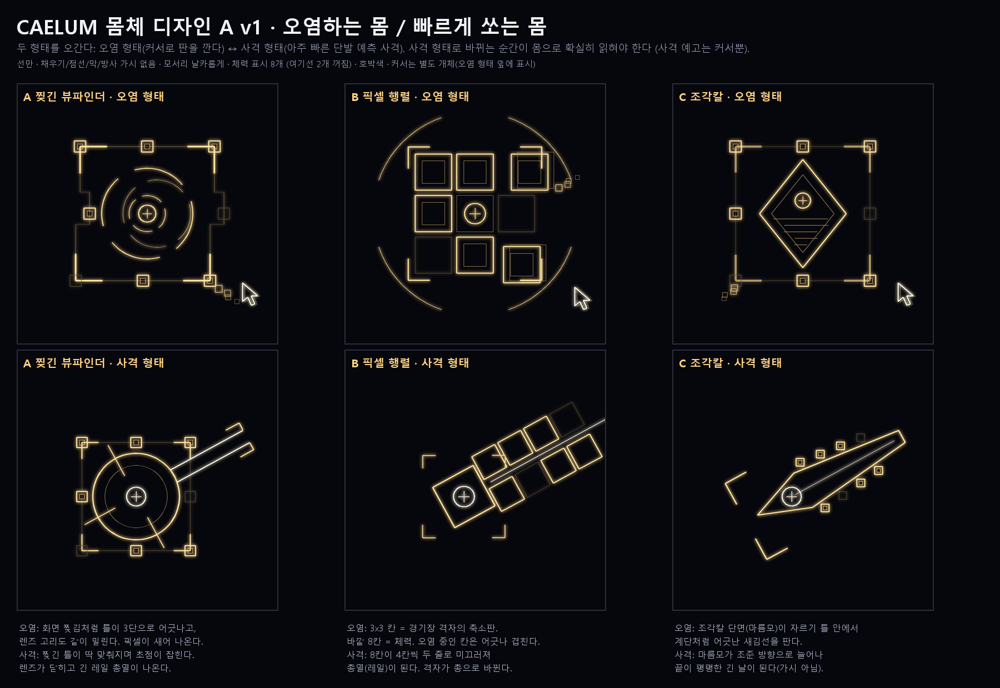
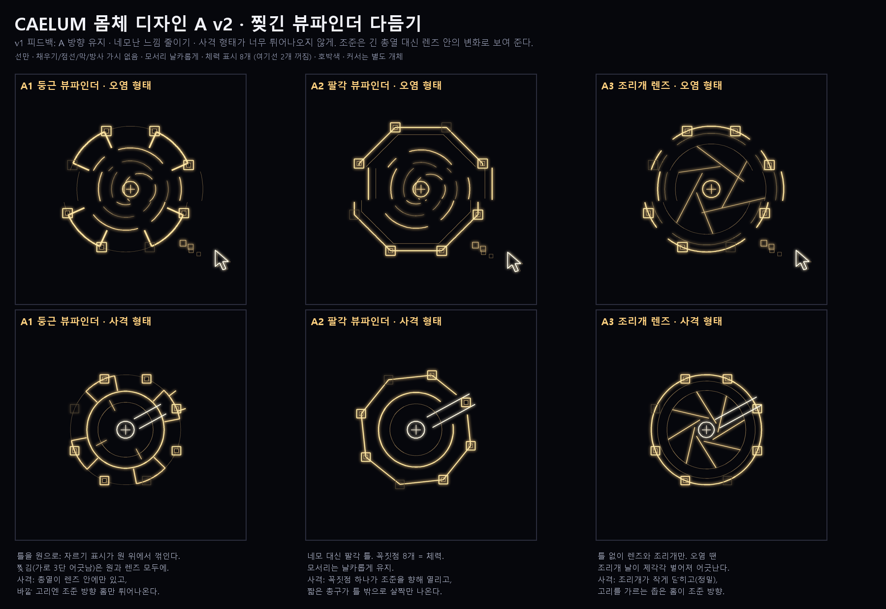

# CAELUM 보스 — 화면을 격자로 오염시키는 손상된 이미지 v2

작성일: 2026-11-01 · 상태: 구현됨(첫 플레이 검증 전) · 수치는 첫 가정 · 코드: `WiNILL/Entity/CaelumBoss.h`(규칙), `WiNILL/Render/CaelumDraw.h`(그리기)

공통 규칙: [보스 몹 공통 규칙](Boss_Enemy_Rules.md) · 같은 계열(창): [NORMA](Norma_Boss_Design.md)

> v2(2026-11-01): v1의 편집 도구 패턴(절단·교환·복제·모자이크)과 노출 과다, 캔버스 모드, 창 최소화를 모두 폐기했다. 바탕화면 이미지도 더 이상 읽지 않는다.

## 개념

조각칼자리(Caelum)는 조각가의 끌·판화칼을 본뜬 남반구 별자리다. "프로그램된 우주"에서 하늘(바탕화면)은 한 장의 이미지 파일이고, **CAELUM은 그 파일을 칸 단위로 깨뜨리는 손상 그 자체**다.

- 화면을 **288px 고정 크기 격자**로 나눈다(처음 160px에서 1.8배로 키움, 1920×1080에서 7×4칸). 해상도가 달라도 칸 크기가 같아서, 한 칸을 빠져나가는 거리는 늘 같다.
- **오염된 칸**은 지금 화면(바탕화면, 다른 창) 위에 **반투명한 손상 웅덩이**로 덮인다(아래 "웅덩이 모양 오염"). 어두운 막, 깜빡이는 노이즈 픽셀, 옆으로 어긋난 찢김 줄로 되어 있고, 그 위에 가로 주사선과 호박색 테두리를 그린다. 뒤의 화면은 비쳐 보인다.
- 오염된 칸에 서 있으면 **초당 20 피해**를 받고 **약화**된다. 약화는 이동 속도 -30%, CAELUM에게 주는 피해 -30%이고, 칸을 벗어난 뒤 2초간 이어진다.
- 오염은 **시간이 지나면 저절로 회복**된다. 4초(2페이즈 5.5초, ±1초) 뒤 1초에 걸쳐 걷힌다.
- 모든 칸은 오염되기 전에 **0.8초(2페이즈 0.6초) 예고**를 거친다. 테두리가 깜빡이며 굵어지고, 끝무렵엔 손상 무늬가 깜빡여 보인다.
- **CAELUM이 있는 칸은 항상 오염**된다. 보스가 지나간 자리에는 2.5초짜리 오염 자국이 남는다.
- 몸은 **둥근 뷰파인더**다(아래 몸체 디자인 기획의 A1). 핸들 8개가 체력 8등분이며, 가운데는 고리+십자다. 선만 쓴다.

## 몸체 디자인 기획 (2026-11-01, 후보 단계)

조건: **오염을 깔면서 아주 빠른 탄도 쏘는** 보스다. 두 형태(오염 ↔ 사격)를 오가고, 사격 예고는 커서뿐이므로 **형태가 바뀌는 순간이 몸으로 확실히 읽혀야** 한다. 선만, 채우기·점선·막·방사 가시 없음, 모서리 날카롭게, 체력 표시 8개, 호박색. 커서는 몸과 별개 개체다. 그리는 스크립트: `Docs/Concepts/Caelum_Body_Design_A_v1.py`.

| 후보 | 오염 형태 | 사격 형태 | 장점 | 걱정 |
|---|---|---|---|---|
| A 찢긴 뷰파인더 | 자르기 틀이 화면 찢김처럼 3단으로 어긋나고 렌즈 고리가 밀림, 픽셀이 새어 나옴 | 찢긴 틀이 딱 맞춰지며 초점이 잡히고 렌즈가 닫힌 뒤 긴 레일 총열이 나옴 | 지금 몸(자르기 상자 + 조준경)에서 이어짐. "흐트러짐 → 초점"이 전환을 설명함 | 찢김이 작은 화면에서 잘 안 보일 수 있음(어긋남을 더 크게 해야 함) |
| B 픽셀 행렬 | 3×3 칸 = 경기장 격자의 축소판. 바깥 8칸 = 체력, 가운데 = 코어. 오염 중인 칸은 어긋나 겹침 | 8칸이 4칸씩 두 줄로 미끄러져 총열(레일)이 됨. 격자가 총으로 바뀜 | 격자 오염 개념과 바로 연결. 체력 8칸이 자연스러움. 변신이 가장 극적이고 멀리서도 읽힘 | 칸이 움직이는 연출(0.6초 변신)을 새로 만들어야 함 |
| C 조각칼 | 조각칼 단면(마름모)이 자르기 틀 안에서 계단식 새김선을 팜 | 마름모가 조준 방향으로 늘어나 끝이 평평한 긴 날이 됨 | 별자리 이름(조각칼)에 가장 충실 | 사격 형태가 칼·가시처럼 읽혀 "가시 금지" 규칙에 걸릴 수 있음 |

추천: **B**. 오염(격자)과 빠른 탄(레일)이 같은 칸들로 표현되고, 형태 전환이 가장 분명하다. A는 지금 몸을 다듬는 안전한 대안이다.

**A 방향 선택 (2026-11-01).** 사용자 피드백: A로 가되 **네모난 느낌을 줄이고**, 사격 형태에서 **총열이 너무 튀어나오지 않게**. → A v2 시안 세 가지:

| 후보 | 오염 형태 | 사격 형태 |
|---|---|---|
| A1 둥근 뷰파인더 | 원형 틀 위에서 꺾인 자르기 표시, 틀·렌즈가 가로 3단으로 찢겨 어긋남 | 총열이 렌즈 안에만 있고, 바깥 고리에 조준 방향 홈만 살짝 나옴 |
| A2 팔각 뷰파인더 | 팔각 틀(꼭짓점 8개 = 체력), 찢김 | 꼭짓점 하나가 조준을 향해 열리고 짧은 총구가 틀 밖으로 조금만 나옴 |
| A3 조리개 렌즈 | 틀 없이 렌즈와 조리개만, 조리개 날이 제각각 벌어져 어긋남 | 조리개가 작게 닫히고(정밀), 고리를 가르는 좁은 홈이 조준 방향 |

스크립트: `Docs/Concepts/Caelum_Body_Design_A_v2.py` (A v1의 도우미를 가져다 씀).

**확정: A1 둥근 뷰파인더 (2026-11-01, 게임에 반영).** `CaelumDraw.h`의 `DrawBody`.
- 오염 형태: 희미한 원형 틀, 그 위에서 꺾인 자르기 표시 4개(안쪽으로 짧은 팔), 4호짜리 렌즈 고리 3겹이 천천히 돈다. 전체가 가로 3단으로 찢겨 아래 두 단이 옆으로 어긋나고(0.2초마다 다시 굴림), 오른쪽 아래로 빈 픽셀 네모가 새어 나온다.
- 사격 형태(형태 전환 0.6초에 섞임): 찢김이 닫히고 틀이 12% 줄어들며 렌즈 고리가 완전한 원이 된다. 자르기 표시 하나가 조준 방향으로 돌고, 코어에서 렌즈 테두리까지 짧은 총열 두 줄, 틀 바깥으로 살짝 나오는 홈, 나머지 세 방향의 초점 눈금이 생긴다. 코어는 흰빛.
- 체력: 틀 위 8개 핸들(꺼지는 순서는 이전과 같음). 2페이즈: 찢김이 커지고 자르기 표시가 틀 밖으로 밀려난다.

## 구성 (컨셉 1 · 기믹 3 · 조건부 1 · 2페이즈 1 · 상시 충격파)

| # | 분류 | 이름 | 한 줄 |
|---|---|---|---|
| 1 | 컨셉 | **오염 확산** | 씨앗 칸(첫 씨앗은 플레이어 칸)이 오염되고 세대마다 이웃 한 칸으로 번진다 |
| 2 | 기믹 | **손상 줄** | 기록 헤드가 플레이어를 지나는 행(또는 열)의 5칸 구간을 오염시키고, 빈틈 한 칸만 남긴다 |
| 3 | 기믹 | **웅덩이 끌기** | 커서가 먼 웅덩이를 들어 올려 플레이어 쪽으로 끌고 다니며 번지게 한다. 끌수록 작아진다 |
| 4 | 기믹 (사격 형태) | **예측 사격** | 아주 빠른 단발 탄을 플레이어가 갈 자리로 쏜다. 떨어진 칸이 오염된다 |
| 5 | 조건부 | **파일 손상** | 오염이 화면의 30%를 넘으면 오염이 한 칸씩 부풀어 터진 뒤 모두 걷힌다 |
| 6 | 2페이즈 | **침식** | 플레이어가 한 칸에 1.6초 머물면 그 칸이 오염된다 |
| 7 | 상시 | **충격파** | 패턴과 상관없이 보스 몸 또는 화면을 가로지르는 직선에서 충격파가 나가 플레이어를 한 칸(288px) 밀쳐낸다 |

### 1. 오염 확산 (컨셉)
- 씨앗 2개(2페이즈 3개). 첫 씨앗은 플레이어 칸이고, 나머지는 무작위 칸이다.
- 씨앗이 오염된 뒤 0.55초마다 한 세대씩, 이전 세대의 각 칸이 깨끗한 이웃 1칸을 감염시킨다. 2세대(2페이즈 3세대)까지 번진다(씨앗 하나당 최대 3칸, 2페이즈 4칸).
- 대응: 깜빡이는 칸을 벗어나고, 번지는 방향을 읽는다.

### 2. 손상 줄
- 플레이어를 가운데 둔 행이나 열의 **5칸 구간**을 기록 헤드가 초당 12칸씩 지나가며 칸마다 예고를 건다. 2페이즈에는 행과 열 둘 다 그린다.
- **빈틈 한 칸**은 오염되지 않는다(밝은 꺾쇠 표시). 빈틈은 플레이어 칸에서 2칸 이상 떨어지고, 보스 몸 근처(±1칸)에는 두지 않는다.
- 대응: 표시된 빈틈으로 줄을 건넌다.

### 3. 웅덩이 끌기 (2026-11-02, 웅덩이 끌기을 대체)
- 커서가 플레이어에게서 420px 이상 떨어진 **오염 칸**으로 간다(없으면 그 거리의 깨끗한 칸을 찍어 오염시킨다). 0.35초부터 누르고, 몸을 잡을 때처럼 고리가 조여든다.
- 0.75초에 그 칸과 이웃한 오염 칸 최대 2개를 **한 덩어리로 들어 올린다**(원래 자리는 말라붙는다). 들어 올린 칸이 많을수록 덩어리가 크다.
- 커서가 덩어리를 **플레이어 쪽으로 끌고 다닌다**(초속 330px, 2페이즈 420px). 덩어리는 다른 웅덩이처럼 닿으면 아프고, 지나가는 칸마다 예고 후 오염돼 **번진 자국**이 남는다.
- 덩어리는 **한 칸 움직일 때마다 11%씩 작아지고**, 35%가 되면(또는 6초가 지나면) 커서가 놓는다. 남은 것은 아래 칸으로 스며든다.
- 연계: 놓는 순간 가까운 오염 쪽으로 미는 직선 충격파.
- 실제 OS 창은 더 이상 쓰지 않는다(웅덩이 끌기 폐기).

### 4. 예측 사격 (사격 형태, 2026-11-01, 오염탄을 대체)
- 사격 형태에서만 쓴다. 단발 탄 5발(2페이즈 7발)을 0.5초(2페이즈 0.38초) 간격으로 쏜다. 탄 속도 1700px/s, 피해 18.
- 조준은 **플레이어의 현재 이동을 비행 시간만큼 앞서 읽은 자리**다. 발사 0.4초 전부터 조준선과 조여드는 조준 고리가 보이고, 0.12초 전에 조준이 **고정**된다(선이 굵어짐).
- 탄은 조준점보다 160px 더 날아가 떨어지고, 떨어진 칸이 예고 후 오염된다.
- 대응: 조준이 고정되는 순간 방향을 꺾는다. 일정하게 움직이면 맞는다.

### 5. 파일 손상 (조건부)
- 오염 칸이 전체의 30% 이상이 되면 발동한다(쿨다운 10초).
- 1.2초 동안 오염 칸 테두리가 번쩍이고, 오염에 맞닿은 깨끗한 칸까지 빗금으로 표시된다. 그 뒤 터지면서 그 범위에 있으면 피해 30을 한 번 받는다. 이어서 모든 오염이 걷힌다.
- 오염을 방치하면 벌을 받고, 동시에 경기장이 초기화되는 구조다.

### 6. 침식 (2페이즈 상시)
- 플레이어가 같은 깨끗한 칸에 0.4초 이상 머물면, 그 칸 테두리가 둘레를 따라 차오른다. 1.6초가 되면 그 칸이 예고 후 오염된다.
- 대응: 계속 움직인다.

### 7. 충격파 (상시)
- 전투 시작 2초 뒤부터 4초(2페이즈 3초)마다 패턴과 상관없이 **무조건** 나간다. 2페이즈 전환 무적 중에는 멈춘다.
- **보스 기점**과 **직선 기점**이 번갈아 나온다.
- 직선 기점: 플레이어 옆 120px에 **화면 끝에서 끝까지 이어지는 직선**을 긋는다(8방향 중 하나). 밀려날 자리에 오염 칸이나 예고 칸이 있으면 그 방향을 고른다. 예고 동안 양쪽에서 선이 모여들고, 발동하면 선이 양쪽으로 700px 퍼지며 닿은 플레이어를 선 반대쪽으로 밀친다. 예고 중 직선을 넘어가면 반대 방향으로 밀린다.
- 아래는 보스 기점 기준이다.
- 예고 1.2초(2026-11-01, 0.9초에서 늘림): 보스 몸(예고 시작 때 위치로 고정)으로 고리 셋이 모여든다. 동시에 플레이어에게서 **밀려날 방향의 선과 착지점(고리+십자)**이 보인다. 착지점이 오염 칸이나 예고 중인 칸이면 붉게 표시된다.
- 발동: 고리가 1400px/s로 화면 끝까지 퍼지고, 고리가 플레이어에 닿는 순간 보스 반대 방향으로 **288px(한 칸)** 밀친다. 거리와 상관없이 같은 거리만큼 밀리며, 피해는 없다.
- **플레이어의 목표는 충격파에 밀려 오염 칸으로 들어가지 않는 것**이다. 착지점이 오염 칸에 떨어지지 않도록, 예고 동안 보스와의 방향을 바꿔 선다. 오염 패턴과 겹치면 템포가 빨라진다.

## 이동과 보스 끌기 (2026-11-02)

**평상시 이동 (오염 형태):** 1.5~2.5초마다 플레이어와 350~650px 떨어진 칸 중심을 골라 초속 200px까지 미끄러져 옮겨 간다. 사격 형태·형태 전환·노출·2페이즈 전환 중에는 멈춘다. 플레이어가 210px 안으로 다가오면(밀치기, 대시) 바로 다른 칸을 고른다. 보스 칸은 늘 오염되므로 지나간 자리에 자국이 남는다(수명 2.5초 → **1.5초**로 줄임).

**5. 보스 끌기 (2페이즈 전용):**
- 커서가 보스 몸으로 가서 0.45초 동안 누른다(몸 둘레로 고리가 조여드는 예고).
- 커서가 몸을 잡고 **직선으로 3번(체력 20% 이하는 4번)** 끈다. 매번 0.5초 동안 갈 경로(선)와 도착점(꺾쇠 틀)을 보여 준 뒤 0.45초에 끈다. 경로는 플레이어를 지나쳐 옆을 스치고, 플레이어 정면으로 돌진하지는 않는다.
- 끌려가는 동안 지나간 칸은 **4초짜리 긴 오염 자국**이 된다. 몸에 닿으면 접촉 피해가 있다.
- 다 끌면 커서가 놓고, 보스 몸에서 **보스 기점 충격파**가 바로 나간다(연계).
- 2페이즈 패턴 순서: 확산 · 끌기 · [사격] · 웅덩이 끌기 · 손상 줄 · [사격] · 끌기 · 웅덩이 끌기 · 확산 · [사격].

## 커서 (2026-11-01)

CAELUM의 손이다. 실제 마우스는 건드리지 않고 화면에 그린다(호박색 화살표 윤곽, 깨진 잔상, 꼬리). 두 형태 모두에서 보이고, 플레이어보다 위에 그린다.

- 평소(할 일이 없을 때): 플레이어와 상관없이 **혼자 화면을 돌아다닌다**. 지금 위치에서 180~650px 떨어진 화면 안의 지점으로 천천히 미끄러져 가고, 0.6~1.6초 머문 뒤 다음 지점을 고른다(2026-11-01, 플레이어 옆에 떠 있던 방식에서 변경). 일을 마치면 원래 있던 자리로 돌아가지 않고, **마친 자리에서 잠시 쉬었다가** 거기서부터 다시 돌아다닌다.
- 확산: 0.32초마다 씨앗 칸을 하나씩 **클릭**한다. 첫 클릭은 **플레이어를 쫓아가 그 칸**을 찍는다. 클릭하면 파문이 퍼진다.
- 손상 줄: 시작 칸으로 간 뒤 줄을 **드래그해 선택**한다. 커서가 곧 기록 헤드다(헤드는 0.3초 늦게 출발).
- 웅덩이 끌기: 먼 웅덩이를 눌러 들어 올리기 → 끌고 다니기 → 놓기.
- 예측 사격(사격 형태): 조준점 위에 올라가 조준이 고정되면 누르고, 탄이 나갈 때 클릭한다.

## 형태 · 연계 · 배드 섹터 (2026-11-01)

"5초 보면 심심하다"는 피드백으로 넣었다. 모든 패턴의 답이 "깜빡이는 칸에서 나가기" 하나였고, 판에 쌓이는 것이 없었다.

- **형태 전환:** 오염 형태(확산·손상 줄·웅덩이 끌기으로 판을 깐다)와 사격 형태(예측 사격으로 선 자리를 벌한다)를 오간다. 판 패턴 2개 → 사격 1번 순서다. 형태가 바뀔 때 0.6초 동안 몸이 변한다. 사격 형태는 자르기 상자가 접히고, 조준경(고리·십자 눈금·총열)이 조준 방향을 향한다.
- **연계 (깔고 → 민다):** 판 패턴은 끝에 직선 충격파를 바로 부른다.
  - 확산: 마지막 세대가 퍼지는 순간, 밀려날 자리가 오염(또는 예고) 칸인 방향으로 민다.
  - 손상 줄: 줄이 다 그어지면 플레이어를 줄 쪽으로 다시 민다. 줄 위(빈틈)에 서 있으면 가까운 오염 쪽으로 민다.
  - 웅덩이 끌기: 커서가 X로 향할 때 플레이어를 창 쪽으로 민다. 창 안에 있으면 가까운 오염 쪽으로 민다.
  - 연계 충격파는 정기 충격파와 별개로 바로 나온다(이미 진행 중이면 그다음에).
- **배드 섹터:** 체력 핸들이 하나 꺼질 때마다 칸 하나가 **영구히 오염**된다(최대 6칸). 플레이어에게서 2칸 이상 떨어지고, 가능하면 다른 배드 섹터와 붙지 않는다. 회복되지 않고, 파일 손상 폭발이나 2페이즈 전환에도 남는다. 파일 손상 발동 계산에는 넣지 않는다. 더 어두운 막과 이중 테두리, X자로 그린다. 시간이 갈수록 경기장이 좁아진다.

## 웅덩이 모양 오염 (2026-11-01)

오염은 여전히 **칸 단위로 생기고 퍼지지만**(확산·손상 줄·웅덩이 끌기·배드 섹터 규칙은 그대로), 보이는 모양과 피해 범위는 격자가 아니라 **쏟은 물처럼 둥근 웅덩이**다.

- 오염된 칸마다 칸 중심에 부드러운 덩어리(메타볼)가 있고, 가장자리가 천천히 출렁인다(칸마다 다른 모양). 혼자 있는 칸의 웅덩이 가장자리는 중심에서 약 0.55칸(출렁이며 0.45~0.63칸).
- 이웃한 오염 칸은 서로 이어져 한 웅덩이가 되고, 대각선 이웃도 가늘게 이어진다. 손상 줄의 빈틈 칸은 열린 채로 남는다.
- **피해와 약화는 웅덩이 안에 있을 때** 받는다. 그리는 것과 같은 계산이라 보이는 대로 맞는다.
- 오염이 막 생기면 웅덩이가 커지며 나타나고, 회복될 때는 말라붙듯 줄어든다.
- 그리기: 반투명 막(허용된 예외) + 가로줄 + 어두운 아래 선 위에 굵은 테두리 + 안쪽 얕은 테두리 + 바깥 잔물결. 웅덩이 안에는 네모(노이즈 픽셀)를 그리지 않는다(사용자 요청).
- 예고 칸은 깜빡이는 테두리가 웅덩이 크기로 부풀어 오른다. 배드 섹터는 더 어두운 막과 두 겹 테두리. 파일 손상이 번질 곳, 웅덩이 끌기이 지울 곳도 같은 곡선 테두리로 미리 보인다.

## 화면 글자 (2026-11-01)

패턴 이름·대처 안내·"파일 손상!" 경고 문구는 모두 없앴다(사용자 요청). 이어서 플레이어 옆의 "약화"와 맞은 원인 문구("-18 예측 사격")도 없앴다. CAELUM 전투에는 보스 이름·체력바 외의 글자가 없고, 모든 것은 선과 커서로 읽힌다(약화는 플레이어 둘레의 고리로 보인다).

## 예고 줄임 (2026-11-01)

- 예측 사격의 **조준선**과 **조준점 고리**를 모두 없앴다. 조준점 위의 커서(누르기 → 클릭)만 예고로 남는다.
- 충격파의 **밀려날 방향 화살표와 착지점 표시**를 없앴다. 충격파 자체의 예고(모여드는 고리·선)만 남고, 어디로 밀릴지는 플레이어가 읽어야 한다.
- 위 7절·4절의 예고 설명 중 이 두 가지는 더 이상 그려지지 않는다.

## 충격파 예고 조정 (2026-11-01)

- 예고 시간 0.9초 → **1.2초**.
- 보스 기점 예고: 몸으로 모여드는 고리 3개(반지름 70~330px)와 발동 직전 부풀어 오르는 고리. 밝은 바탕화면에서도 읽히도록 각 고리 아래에 얇은 어두운 선을 깐다(막 아님, 선마다 처리). 한때 크게 키웠다가 "과하다"는 피드백으로 이 정도로 줄였다.

## 흐름과 수치

| 항목 | 값 |
|---|---|
| 기본 체력 | 24000 (NORMA 30000, 중간 보스라 낮춤) |
| 2페이즈 | 체력 40% 이하. 1.6초 무적 + 모든 오염·탄 해제 |
| 패턴 순서 | 확산 · 손상 줄 · [예측 사격] · 웅덩이 끌기 · 확산 · [예측 사격] · 손상 줄 · 웅덩이 끌기 · [예측 사격] 반복. [ ]는 사격 형태 |
| 노출(공략 틈) | 패턴이 끝날 때마다 1.1초. 피해 1.5배, 몸은 정지·접촉 피해 없음 |
| 패턴 사이 | 0.8초(2페이즈 0.5초) |
| 접촉 피해 | 초당 10 |
| 처치 보상 | XP 40 · 점수 2500 · 별가루 30 |
| 등장 | NIGHTMARE 9웨이브(중간 보스 웨이브)에 CAELUM, 마지막 웨이브는 NORMA |
| 디버그 | F1 > 소환 > 보스 > CAELUM · 스모크 `CAELUMTEST=SPREAD\|SCAN\|SMEAR\|SHOT\|DRAG\|WAVE\|LINE\|BAD\|P2\|ERODE\|OVERFLOW` |

## 사전 점검 · 열린 문제

1. 면 채움 규칙: 오염 칸의 반투명 막·노이즈 픽셀·찢김 줄은 사용자 요청(반투명 오염 무늬)에 따른 예외다. 표식(예고·주사선·화살표·탄·계량)은 선만 쓴다.
2. 패턴이 컨셉 1 + 기믹 3이 되어 기본 1+2+1+1 구조보다 기믹이 하나 많다. 하나를 뺄지 정해야 한다.
3. 오염 범위를 줄였다(2026-11-01: 수명 7→4초, 확산 2칸→1칸, 손상 줄 전체→7칸, 오염탄 지나간 칸 전체→떨어진 칸). 이어서 칸을 160→288px로 키우면서 확산 3→2세대, 손상 줄 7→5칸, 파일 손상 20→30%, 충격파 밀림 240px→한 칸으로 맞췄다. 파일 손상이 너무 드물거나 잦지 않은지 플레이 검증이 필요하다.
4. 약화(이동 -30%)가 걸린 상태에서 다른 패턴을 피하기가 억울하지 않은지 확인해야 한다.
5. 코덱스·도감 항목은 아직 없다.
6. 마지막 웨이브에 CAELUM이 살아 있으면 NORMA 등장 때 보상 없이 물러난다.
